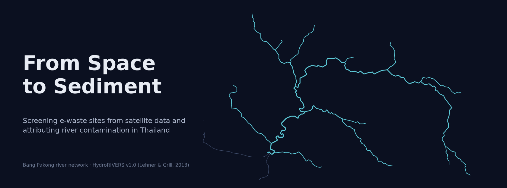
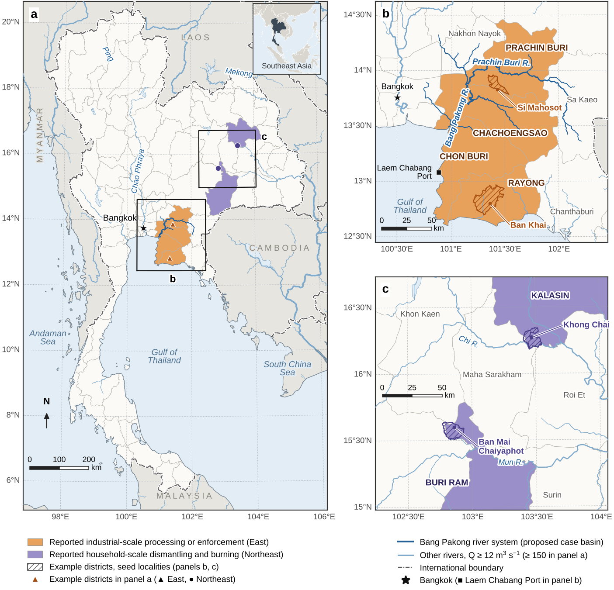
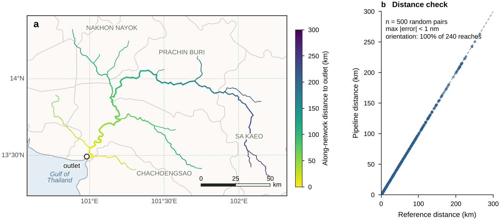

<p align="center"><a href="https://thanatchon36.github.io/from-space-to-sediment/paper/"></a></p>

<p align="center">
<a href="https://github.com/thanatchon36/from-space-to-sediment/actions/workflows/ci.yml"></a>
<a href="pyproject.toml"></a>
<a href="https://thanatchon36.github.io/from-space-to-sediment/paper/"></a>
<a href="paper/paper.pdf"></a>
<a href="docs/data_sources.md"></a>
<a href="LICENSE"></a>
<a href="https://huggingface.co/datasets/thanatchon36/from-space-to-sediment"></a>
</p>

<p align="center">
📖 <b><a href="https://thanatchon36.github.io/from-space-to-sediment/paper/">Read the paper online</a></b> ·
📄 <b><a href="paper/paper.pdf">Download the PDF</a></b> ·
🛰️ <b><a href="gee/fs2s_module1_screening.js">Earth Engine script</a></b> ·
🗂️ <b><a href="docs/data_sources.md">Data sources</a></b> ·
🤗 <b><a href="https://huggingface.co/datasets/thanatchon36/from-space-to-sediment">Dataset</a></b>
</p>

**Screening candidate e-waste processing and dumping sites in Thailand from multi-sensor satellite data,
verifying them against public registries and records, and attributing river contamination to upstream
sources**, with the Bang Pakong basin as the case study. A site is reported as an attributed source only
when four independent lines of evidence agree: detection, hydrological connectivity, geochemistry and
chronology.



> **Status (v2, November 2026).** Framework, implementation and simulation-based validation.
> No real candidate sites are included. The Earth Engine script has been checked statically and
> executed against a mock of the Earth Engine API, but has not yet been run on real imagery.
> Pipeline outputs are **candidates for verification, not findings of illegality.**
> `docs/data_sources.md` is the shopping list for a real run.

## Install and quickstart

```bash
make setup      # uv venv + the package (Python 3.12); installs the fs2s command
make test       # 10 tests: synthetic end-to-end run, river network, parsing and CLI checks
make selftest   # the synthetic run on its own -> tests/synthetic/out (no downloads)
make data       # third-party map data into data/ (Natural Earth, districts, rivers)
make all        # data -> network checks -> figures -> paper -> web reader
```

Outputs: `results/sim_out/` (network checks, simulation replicates, `paper_numbers.json`), `paper/figures/`
and `paper/tables/tab_validation.tex` (generated), `paper/paper.pdf`, and the web reader in `docs/paper/`.
Without uv: `pip install -e ".[dev]"` (Python 3.10 or later).

| Target | Purpose |
|---|---|
| `synthetic` | Write the synthetic end-to-end test data set → `tests/synthetic/`. Never a substitute for real data |
| `selftest` | Synthetic data + verification and attribution → `tests/synthetic/out` |
| `data` | Natural Earth, district boundaries and the HydroRIVERS extract → `data/` |
| `network` | Network checks on the real Bang Pakong network → `results/sim_out/` |
| `sim` | Monte Carlo scenarios 0–3 (`REPS=150` each, about 0.6 s per replicate; resumes) |
| `figures` | Redraw every figure, `results/sim_out/paper_numbers.json` and `paper/tables/tab_validation.tex` |
| `banner` | README banner → `docs/assets/banner.png` |
| `paper` | Build `paper/paper.tex` and `paper/paper.pdf` from `paper/paper.md` (pandoc + tectonic), then the web reader |
| `web` | Web reader only → `docs/paper/index.html`, served at <https://thanatchon36.github.io/from-space-to-sediment/paper/> |
| `arxiv` | arXiv source bundle → `paper/arxiv.tar.gz` (checks it compiles; prints title, abstract and comments for the form) |
| `hf` | Publish the Hugging Face dataset (`scripts/publish_hf.py`) |

Every target calls the `fs2s` command (`python -m from_space_to_sediment.cli`); `fs2s --help` lists them.
`results/sim_out/` already holds the simulation results used in the paper, so `make figures` redraws the
figures without re-running the simulation. To re-run it, delete `results/sim_out/sim_results_s*.csv` and
run `make sim`.

## What the pipeline does

1. **Screening in Google Earth Engine** (Module 1, `gee/fs2s_module1_screening.js`): thermal, optical,
   radar, night-time light and pond proxies are combined into a screening score per candidate footprint.
   The score is a heuristic, not a probability; calibrate it with verified labels (`--labels`).
2. **Registry gap** (`from_space_to_sediment.verify_trace`): candidates near a licensed category 101/105/106
   factory are marked licensed; a registered factory of another category nearby is flagged for
   registry-mismatch review.
3. **Known sites and hard negatives**: sites already reported in news, enforcement or NGO records become
   known seeds; candidates within the buffer of a known look-alike (for example a rice mill) are excluded.
4. **Calibration**: isotonic regression on verified labels turns the screening score into a site
   probability `p_i`.
5. **River network**: candidates and stations are snapped to HydroRIVERS, MERIT-Basins or any network;
   reach orientation is inferred, and distances are measured along the network, downstream only.
6. **Geochemistry and linkage**: marker anomalies (Cu, Pb, Sn, Sb, Cd, …) against reference stations and
   upstream/downstream pairs; the decay scale λ of the loading index is chosen by rank correlation with a
   permutation test.
7. **Evidence levels**: **attributed** = C1–C4, **probable** = C1 + C2 + C3, **possible** = any two
   criteria. `--evidence-rule count` restores the original count-based rule.
8. **Outputs**: exact locations go only to `*_RESTRICTED*` files; the public product is a 5 km grid summary.
9. **Validation** (`from_space_to_sediment.sim_validate`): network checks on the real Bang Pakong network
   and Monte Carlo scenarios with synthetic sites and stations on it (paper, Section 9).

## Verification and downstream attribution on your own data

```bash
fs2s verify \
  --candidates bangpakong_candidates.csv --factories diw_factories.csv \
  --known known_sites.csv --negatives hard_negatives.csv \
  --rivers HydroRIVERS_v10_as.shp --stations stations.csv --matrix sediment \
  --admin subdistricts.geojson --outdir out_bangpakong
```

| Input | Required columns | Optional columns |
|---|---|---|
| candidates (from GEE) | site_id, lon, lat | screening_score, activity_index, proxies, s_struct, s_thermal, s_ntl, s_pond, first_built_year, flood_freq_max |
| diw_factories | fac_id, category, lon, lat | fac_name, status, license_no |
| known_sites | lon, lat | ref_id, source_type, source_ref, date_reported, precision_m |
| hard_negatives | lon, lat | neg_id, neg_type, buffer_m |
| stations | station_id, lon, lat, at least one marker | sample_date, matrix, unit, is_reference, cu, pb, sn, sb, cd, ni, zn, al, fe, pbde_total, pcddf_teq |
| labels | site_id, verified (1/0) | method, date_verified |
| cores | station_id, onset_year, onset_year_sd | |

Coordinates are WGS 84 decimal degrees. Factory categories such as "105(1)" or "ลำดับที่ 106" are
parsed automatically; values reported as "<DL" become DL/2. Rivers can be HydroRIVERS
(`--river-format hydrorivers`), MERIT-Basins (`meritbasins`) or any network (`custom`). Templates for
every table are in [`templates/`](templates/); where to get each one is in
[`docs/data_sources.md`](docs/data_sources.md).

On the synthetic data (`make selftest`), site S_A is *attributed*, S_C is licensed, S_D is a known seed,
S_E is a hard negative and S_G is flagged for registry-mismatch review; `make test` checks all of these.

**Earth Engine.** Open `gee/fs2s_module1_screening.js` in the Code Editor and edit `CFG`.
Optional assets: the FIRMS VIIRS 375 m archive for Thailand (uploaded as a table asset with
`latitude`/`longitude` columns) and industrial-estate polygons. Run the script and start the three
export tasks: candidates (CSV), footprints (SHP) and wet-season flood frequency (GeoTIFF).

## Research: *From Space to Sediment: An Integrated Multi-Sensor Remote Sensing and Geochemical Fingerprinting Framework for Detecting E-Waste Hotspots and Attributing River Contamination in Thailand*

The preprint by Thanatchon Chongmankhong is in [`paper/`](paper/): a PDF in [`paper/paper.pdf`](paper/paper.pdf)
and its source in [`paper/paper.md`](paper/paper.md), which pandoc turns into the LaTeX file `paper/paper.tex`
(arXiv layout, [`paper/template.tex`](paper/template.tex) and [`paper/arxiv.sty`](paper/arxiv.sty)). `make arxiv`
packs that file with its figures into `paper/arxiv.tar.gz` and checks the bundle compiles on its own. The same
source builds the [web version](https://thanatchon36.github.io/from-space-to-sediment/paper/). Every simulation
number in the text is a placeholder filled from `results/sim_out/paper_numbers.json`, and Table 5 is written by
`paper/figures_src/fig8_simulation.py`, so `make sim figures paper` replaces them all.

- Tables: [`paper/tables/`](paper/tables/) · Figures: [`paper/figures/`](paper/figures/) · the scripts that draw
  them: [`paper/figures_src/`](paper/figures_src/)
- Dataset on Hugging Face: [`thanatchon36/from-space-to-sediment`](https://huggingface.co/datasets/thanatchon36/from-space-to-sediment),
  with the simulation replicates, the network checks, the synthetic test set and the input templates
- Section 9, *Implementation and simulation-based validation*: exact along-network distances on the real
  Bang Pakong network and 600 simulated replicates; they showed the count-based rule was too permissive,
  so geochemical evidence is now required for a probable attribution.

<p align="center"></p>

## Repository layout

```
src/from_space_to_sediment/
  config.py                 paths and URLs
  verify_trace.py           verification and downstream attribution (Modules 1 and 3)
  synthetic.py              synthetic end-to-end test data
  sim_validate.py           network checks and Monte Carlo validation (paper, Section 9)
  paper_build.py            placeholder filling + pandoc -> paper.tex + tectonic
  paper_web.py              web reader docs/paper/
  cli.py                    fs2s {synthetic,selftest,verify,network,sim,figures,paper,web}
gee/fs2s_module1_screening.js   Earth Engine screening (Module 1)
templates/                  CSV templates for the input tables
results/sim_out/            network-check and simulation results, paper_numbers.json
paper/                      paper.md, template.tex, arxiv.sty, references.bib, paper.bbl, reader.html,
                            tables/, figures/, figures_src/, paper.pdf
docs/                       GitHub Pages (web reader in docs/paper/), data_sources.md, README assets
scripts/                    download_data.py, make_banner.py, arxiv_bundle.py, publish_hf.py
tests/                      synthetic end-to-end run, river network, parsing, CLI
data/                       empty until make data is run
```

## Data sources

[`docs/data_sources.md`](docs/data_sources.md) lists every input for a real run and where it comes from. The
figures and simulations use third-party data that are not redistributed here; `make data` fetches them:

- Natural Earth boundaries, coastline and lakes (public domain).
- HydroRIVERS v1.0 (Lehner & Grill, 2013), via the extract in github.com/oadtz/waterways.
  Check the HydroSHEDS licence terms before redistributing derived data.
- District boundaries from github.com/chingchai/OpenGISData-Thailand (CC BY 4.0).

## Responsible use

- Treat every output as a candidate for verification. Do not name facilities or publish exact
  coordinates; publish aggregated products only (paper, Section 10).
- Files whose names contain `_RESTRICTED` hold exact coordinates and are excluded by `.gitignore`.
  Share exact locations only with competent authorities such as the Department of Industrial Works
  and the Pollution Control Department.

## Limitations

No real candidate sites; the Earth Engine script has not yet been run on real imagery; the validation
uses synthetic sites and stations on the real network topology; the screening score is a heuristic until
calibrated with verified labels. Empirical results on real data will be reported separately. See paper,
Section 11.

## Citation

See [`CITATION.cff`](CITATION.cff); each release is archived on Zenodo. License: MIT ([`LICENSE`](LICENSE)).

## AI assistance

Parts of the text, code and figures were drafted with an AI system (Claude, Anthropic) and reviewed
by the author, who takes responsibility for the content.

## ภาษาไทย (สรุป)

คลังนี้มีเปเปอร์ "From Space to Sediment" และโค้ดสำหรับคัดกรองพื้นที่ต้องสงสัยว่าเป็นแหล่งคัดแยก/ทิ้ง
ขยะอิเล็กทรอนิกส์จากข้อมูลดาวเทียม (Google Earth Engine) ตรวจสอบกับทะเบียนโรงงาน 101/105/106
และประวัติข่าว แล้ววิเคราะห์การเชื่อมโยงกับการปนเปื้อนในลำน้ำท้ายน้ำ เริ่มจาก `make setup` และ
`make test` (ชุดทดสอบสังเคราะห์ ไม่ต้องดาวน์โหลดข้อมูล) อ่านเปเปอร์ออนไลน์ได้ที่
<https://thanatchon36.github.io/from-space-to-sediment/paper/> ผลลัพธ์ทุกจุดเป็น "พื้นที่ต้องสงสัย"
ไม่ใช่ข้อสรุปว่าผิดกฎหมาย และไฟล์ที่มีคำว่า `_RESTRICTED` มีพิกัดจริง ห้ามเผยแพร่
